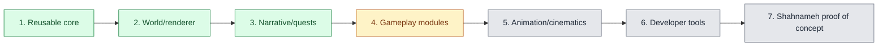

# محله‌ی مهربانی — game-kids-turn-based-rpg

A nonviolent, offline-first, Persian (RTL) turn-based RPG vertical slice for children aged 3–7,
built to the specification in [`.plans/1st.md`](.plans/1st.md).

> **Draft content.** Every educational and religious record in this repository is a clearly marked
> `draft` placeholder with empty quotation and citation fields. Nothing here is an authentic hadith
> or a verified religious quotation, and nothing may be shipped as educational material until named
> reviewers supply permissioned editions and approve them. See [Content governance](#content-governance).

No backend, accounts, analytics, ads, third-party runtime requests, remote fonts, combat,
microphone, geolocation or device identifiers. Progress lives only in the browser's IndexedDB.

<!-- framework-roadmap:begin -->
<!-- prettier-ignore-start -->

## Framework roadmap

**3/7 phases completed** · Next: **Phase 4 — Gameplay modules** · [Full roadmap and exit gates](docs/FRAMEWORK-ROADMAP.md)



| Phase | Status | Evidence |
| --- | --- | --- |
| 1. Reusable core | ✅ Complete | [PR #110](https://github.com/hmmftg/game-kids-turn-based-rpg/pull/110) |
| 2. World/renderer | ✅ Complete | [PR #111](https://github.com/hmmftg/game-kids-turn-based-rpg/pull/111) |
| 3. Narrative/quests | ✅ Complete | [PR #113](https://github.com/hmmftg/game-kids-turn-based-rpg/pull/113) |
| 4. Gameplay modules | ➡️ Next | — |
| 5. Animation/cinematics | ⏳ Planned | — |
| 6. Developer tools | ⏳ Planned | — |
| 7. Shahnameh proof of concept | ⏳ Planned | — |

_Generated from the canonical roadmap. Update status and evidence in [docs/FRAMEWORK-ROADMAP.md](docs/FRAMEWORK-ROADMAP.md), then run npm run roadmap:sync._

<!-- prettier-ignore-end -->
<!-- framework-roadmap:end -->

## Library-backed reference game

This repository's root app, **محله مهربانی**, is a real first-party
`waypoint-rpg-core` consumer for its runtime and navigation, not a separate
mock scene. Its child-specific dialogue, replayable quests, battle rules,
renderer, IndexedDB profile saves, and content policy remain game-owned until
tested equivalent library APIs are adopted.

See the [library adoption matrix](docs/MAHALLE-LIBRARY-ADOPTION.md) for what is
already integrated and what remains to migrate. Real source-rendered screenshots
are captured with Playwright on merges to `main`, published as Actions artifacts,
and proposed for the README gallery through a reviewable documentation PR.

To capture them locally after installing Chromium, run
`npm run build && npm run sample:previews`. This capture suite is separate
from the regular E2E regression shards.

## Requirements

- Node.js 22.22.2 or newer in the Node 22 line, with npm 10.x (the repo is developed on Node 22.23.5 and npm 10.9.9)
- On Windows use `npm.cmd` for every command below

## Setup

```bash
npm ci
npm run dev          # http://localhost:5173
```

## Scripts

| Script                             | Purpose                                                                   |
| ---------------------------------- | ------------------------------------------------------------------------- |
| `npm run dev`                      | Vite dev server                                                           |
| `npm run dev:linked`               | Package watch build followed by Vite, for live core-library edits         |
| `npm run framework:watch:check`    | Chromium check for linked updates, failed-build preservation and recovery |
| `npm run build`                    | Content validation → strict `tsc -b` → production bundle → budget check   |
| `npm run preview`                  | Serve `dist/` on port 4173 (used by Playwright)                           |
| `npm run typecheck`                | Strict TypeScript project build                                           |
| `npm run lint` / `lint:fix`        | ESLint (flat config, type-aware)                                          |
| `npm run format` / `format:check`  | Prettier                                                                  |
| `npm test`                         | Vitest unit + component tests (jsdom)                                     |
| `npm run test:e2e`                 | Playwright golden paths against the production preview                    |
| `npm run validate:content`         | Content/provenance validation (development mode: drafts warn)             |
| `npm run validate:content:release` | Release gate: **fails** while any reachable record is not `approved`      |
| `npm run check:budgets`            | Gzip transfer budgets over `dist/`                                        |
| `npm run framework:build`          | Compile the dependency-free ESM core package                              |
| `npm run framework:consumer`       | Pack and verify an isolated tarball consumer                              |
| `npm run verify`                   | format:check → lint → package boundary/build/tests → app gates            |

## Architecture

```
src/
  domain/      pure TypeScript: state machine, quests, encounters, save schema (no React, no Three)
    game/      modes, commands, reducer, checkpoints, selectors, versioned save + migration
    quests/    quest definitions, ordered prerequisites, encounter phase machine
  content/     typed Persian copy, icon semantics, provenance records, validation
  world/       React Three Fiber hub: canvas, cubic model provider, waypoint graph + A*
  ui/child/    DOM HUD: screens, dialogue cards, pictogram choices, quest trail, stickers, pause
  ui/parent/   press-and-hold gate, sources/credits/privacy/diagnostics/reset
  services/    persistence (IndexedDB + memory fake), audio, device capabilities, PWA lifecycle
  app/         React provider wiring domain ↔ services ↔ UI, error boundary
e2e/           Playwright golden paths
scripts/       content validation and build budget checks
packages/core/ dependency-free ESM package, public root at waypoint-rpg-core
```

Key rules the code enforces:

- **Domain purity.** `src/domain/` imports nothing from React, Three.js or the DOM. Every transition
  is a pure function of `(state, command, now)`, invalid transitions return the _same object_, and
  autosave only fires after a stable transition (`title`, `avatarSelect`, `hub`, `parentArea`).
- **Encounter machine.** `intro → demonstrate → playerChoice → worldResponse → reinforce → complete`.
  A wrong pick returns to `demonstrate`, increments a retry counter and never fails, shames or blocks.
- **Persistence.** Only schema version, avatar id, quest progress, checkpoint, stickers, audio
  settings, quality tier, the current map/anchor and discovered world facts, and a timestamp are stored. React/Three objects and device identifiers are
  never persisted. Corrupt saves fall back to a fresh state without deleting the bad payload; reset
  is only reachable from the parent area.
- **Rendering.** `frameloop="demand"` with explicit `invalidate()` during movement, a locked
  orthographic camera, one hemisphere + one directional light, blob shadows (no shadow maps),
  capped device pixel ratio per quality tier, visibility pause, and raycasting restricted to the
  ground plane and hotspot rings.
- **RTL UI in the DOM.** All text lives outside the canvas so Persian shaping, fonts and assistive
  technology behave correctly. Child controls are ≥64×64 CSS px.

### Replacing the cubic art with real models

`src/world/models/modelProvider.ts` defines the `ModelSet` boundary (`Figure`, `Landmark`, `Prop`).
`CUBIC_MODELS` is the current implementation; supplying a GLB-backed `ModelSet` through
`ModelContext` swaps the art without touching quest, navigation or state logic. Both avatars are
mechanically identical — only palettes differ — so new models must keep identical proportions.

Audio follows the same pattern: `src/services/audio/manifest.ts` lists assets with `url: null` and
`licence: 'placeholder-silence'`. The game is fully playable silent; replacing a placeholder means
adding a locally bundled file plus written licence and attribution in the manifest entry.

## Content governance

- Every quest, dialogue node and source record carries `review: { status, reviewer, reviewedAt }`,
  and all of them are currently `draft` with blank reviewer fields.
- Source cards keep `arabicQuotation`, `persianTranslation` and every citation field empty, and all
  reproduction-rights flags are `false`. No religious text is reproduced anywhere in this repository.
- Child-facing copy is a plain Persian behaviour summary only. `src/content/validation.ts` rejects
  shame, fear, violence, punishment and quantified spiritual merit vocabulary.
- `npm run validate:content` (run automatically by `build`) reports drafts as warnings so the slice
  stays developable. `npm run validate:content:release` is the release gate and **fails** while any
  production-reachable record is not `approved` — wire it into any publishing pipeline.
- Promotion path: a named reviewer supplies a permissioned edition → fill quotation, translation,
  full citation and rights → set `status: 'approved'` with reviewer name and date → release
  validation passes.

## Testing matrix

| Layer        | Tool                     | Covers                                                                                         |
| ------------ | ------------------------ | ---------------------------------------------------------------------------------------------- |
| Domain       | Vitest                   | every transition, invalid transitions, prerequisites, checkpoints, idempotence                 |
| Save         | Vitest                   | schema validation, v1→v2 migration, clamping, corrupt and future-version saves                 |
| Persistence  | Vitest + fake-indexeddb  | repository contract, memory fake, corrupt payload reporting                                    |
| Navigation   | Vitest                   | waypoint graph, A*, nearest-anchor resolution, non-walkable rejection                          |
| Content      | Vitest                   | draft invariants, empty citations, forbidden vocabulary, release gate                          |
| Components   | Vitest + Testing Library | title → avatar → hub, gentle retry, parent gate                                                |
| Golden paths | Playwright               | first run, both avatars, three quests + finale, refresh/resume, offline replay, WebGL fallback |

```bash
npm test
npx playwright install --with-deps chromium   # once
npm run test:e2e
```

## PWA, offline and deployment

`vite-plugin-pwa` (Workbox `generateSW`, `registerType: 'prompt'`) revisioned-precaches the shell and
slice assets; `public/manifest.webmanifest` requests `standalone` + `landscape` with local icons.
Updates are never applied mid-play: the waiting worker is only activated from the pause menu.
`public/offline.html` covers a first visit that never finished caching.

Deploy `dist/` to any static host over HTTPS (service workers require it):

```bash
npm run verify
npm run validate:content:release   # must pass before shipping as educational material
# upload dist/
```

Host requirements: serve `index.html` for unknown routes, do not rewrite `sw.js` caching headers to
something long-lived, and keep the app on its own origin path. The build is same-origin only; the
CSP in `index.html` forbids any third-party connection.

Current production transfer (gzip): ~376 KB total, well inside the <10 MB budget enforced by
`scripts/check-budgets.ts`.

## Licence

Code: MIT (see `LICENSE`). Font: Vazirmatn under the SIL Open Font License, bundled as a local
subset. No other third-party runtime asset is included.
