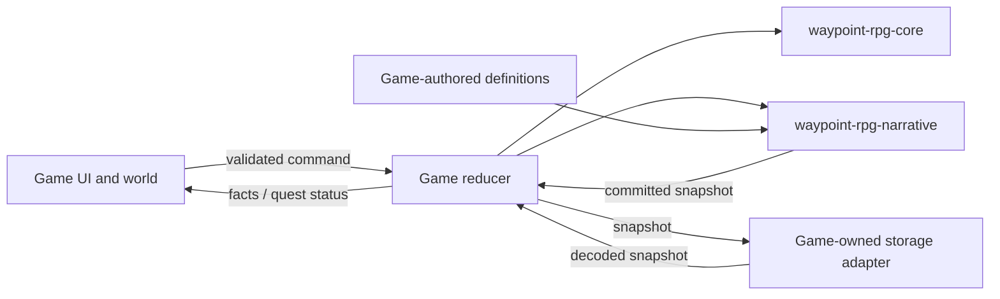

# Creating a game with the Waypoint RPG packages

This guide describes the packages and integration points that exist in this
checkout. It uses Garden of Stories as a complete example. A new game should
author its own world, characters, story, interface, renderer, and storage
policy, while consuming reusable behavior from the two package roots.

## Package ownership

| Reusable package         | Provides                                                                                                                                           | Remains game-owned                                                                                     |
| ------------------------ | -------------------------------------------------------------------------------------------------------------------------------------------------- | ------------------------------------------------------------------------------------------------------ |
| `waypoint-rpg-core`      | Generic reducer runtime, world/map/anchor types, graph navigation, pathfinding, persistence contracts                                              | Application state, commands, movement policy, spatial checks, world content, renderer, storage adapter |
| `waypoint-rpg-narrative` | Definition validation/compilation, conditions, typed effects, dialogue cursors, quest transitions, replay protection, state decoding and selectors | Narrative definitions and copy, valid interaction mapping, save envelope, interface, scene effects     |



The core and narrative packages deliberately have different roles. Narrative
is optional; a world-navigation game can install core without the narrative
package. Neither package contains a renderer, game story, browser UI, or
browser storage implementation.

## Start with a game-owned runtime

Import only public package roots. The packages do not support private deep
imports. Keep one runtime store as the authoritative owner of committed game
state, and put all durable state transitions in its reducer:

```ts
import { createGameRuntime, findPath } from 'waypoint-rpg-core';
import type { AnchorId } from 'waypoint-rpg-core';

interface State {
  readonly mapId: 'village' | 'garden';
  readonly anchorId: AnchorId;
}

type Command =
  | { readonly type: 'MOVE_TO'; readonly anchorId: AnchorId }
  | { readonly type: 'ARRIVE'; readonly anchorId: AnchorId };

const runtime = createGameRuntime<State, Command>({
  createInitialState: () => initialState,
  reducer(state, command) {
    // Validate map, route, and committed arrival here before returning new state.
    return reduceGameCommand(state, command);
  },
});
```

The concrete game may use a smaller or richer state and command union. The
runtime supplies state access, dispatch, subscription, and disposal; it does
not choose the game's rules. Use `findPath(graph, startId, targetId)` and other
core world helpers for declared graph navigation. A reachable path is not an
arrival: the game must dispatch and validate its own arrival command before
allowing target interaction or narrative effects. Check exact map, committed
anchor, and other spatial rules in the reducer or application-owned command
boundary.

Garden's `src/game/runtime.ts` shows these checks, including guarded route IDs,
per-waypoint `ARRIVE`, valid map transitions, and an exact-target interaction
requirement. Its DOM and 3D scene both dispatch commands; neither edits state
directly.

## Author and compile the story

Write a `NarrativeDefinition` in the game package, keeping stable IDs and
locale-keyed copy with that game. The current public API supports versioned
definitions, dialogues, choices, conditions, typed effects, quests, and
triggers. Validate definitions and compile once at runtime creation:

```ts
import {
  compileNarrative,
  createNarrativeState,
  getDialogueView,
  getFact,
  getQuestStatus,
  transitionNarrative,
  validateNarrative,
  type NarrativeDefinition,
} from 'waypoint-rpg-narrative';

const definition: NarrativeDefinition = authoredStory;
const diagnostics = validateNarrative(definition);
if (!diagnostics.ok) throw new Error('Fix the authored narrative diagnostics');
const compiled = compileNarrative(definition);
let narrative = createNarrativeState(compiled, newPlaythroughId());

const result = transitionNarrative(compiled, narrative, {
  type: 'open-dialogue',
  dialogueId: definition.entryDialogueId,
  playthroughId: narrative.playthroughId,
  expectedRevision: narrative.revision,
});
if (result.accepted) narrative = result.state;

const dialogue = getDialogueView(compiled, narrative, 'fa');
const questStatus = getQuestStatus(compiled, narrative, 'my-quest');
const worldFact = getFact(narrative, 'my-world-change');
```

Actual transition commands are discriminated by `type` (`open-dialogue`,
`choose`, `advance`, `exit-dialogue`, `finish`, or `trigger`). Each command must
include the current `playthroughId` and `expectedRevision`. The result says
whether the transition was accepted; only replace state with an accepted
result. These checks reject stale or replayed commands and keep the transition
deterministic. `getDialogueView`, `getQuestStatus`, and `getFact` are selectors;
they do not mutate the story.

Garden stores its story at `examples/garden-adventure/src/content/story.ts`.
Its triggers declare both condition and effects. Application code first checks
the active map, committed arrival, and exact target, then submits only a known
trigger ID with `transitionNarrative`. There is no arbitrary effect callback or
general event-bus API.

## Project facts into the game world

The reducer stores the accepted narrative snapshot alongside the app-owned map
and anchor. React UI and scene components read facts and quest selectors from
the committed snapshot. For example, Garden maps `tree-grown` to a blossoming
tree and `lantern-lit` to a lit lantern. A scene displays these facts; it does
not complete quests or call narrative effects directly.

World registrations, scene loading/unloading, camera choice, pointer/touch
ownership, keyboard controls, and cleanup are app-owned. The
`examples/scene-demo/` and `examples/garden-adventure/` directories show two
small independent 3D hosts. Their private files are examples, not shared
modules to import. Do not add a renderer package solely to reuse a small scene
component.

For replaceable art, expose sample-owned model components with stable props
such as position, target type, and narrative facts. Keep interaction and game
state outside those components. Locally licensed GLB models can replace the
procedural component bodies without changing story or navigation logic.

## Own storage and recovery in the game

The narrative package defines a JSON-compatible snapshot but never reads
storage. The core package publishes generic persistence contracts, but does
not provide the browser repository, boot coordinator, or save schema for a
particular game. Define an application-owned envelope that includes a schema
version, game identity, content/compatibility version, active map, committed
anchor, and narrative snapshot. Namescope browser keys to that sample.

Use `decodeNarrativeState(compiled, value)` to validate narrative state and
classify unsupported or structurally incompatible content. Validate the map
and anchor against the game's current world. Then restore through a game
command, keeping reducers and framework packages free of `localStorage` or
IndexedDB calls. Explicitly choose how the game preserves bad bytes, offers a
temporary session, handles reset, and saves only after stable transitions.

Garden implements this in `src/persistence/garden-save.ts` with the isolated
`waypoint-rpg:garden-adventure:save` key, strict envelope checks, temporary
recovery, manual and arrival autosave, and reset. The reducer accepts only the
decoded plain snapshot through `RESTORE_GAME`.

## Verify installed packages, not only workspace links

Workspace builds prove the API works in the monorepo. An independent consumer
should pack the compiled packages, install those archives in a temporary
directory outside the checkout, resolve JavaScript and declarations from the
package roots, and reject private deep imports. Then build and run its browser
smoke from that isolated installation.

From this repository, the Garden gate is:

```bash
npm run framework:garden-consumer
```

It copies the sample outside the repository, installs the locked development
toolchain separately, installs the locally packed core and narrative tarballs
offline, verifies ESM and TypeScript declarations, and runs unit/build/browser
checks. Offline archive installation does not imply that a fresh Vite,
TypeScript, or Playwright toolchain can be installed offline.

## Useful sample commands

```bash
npm run sample:garden:dev
npm run sample:garden:build
npm run sample:garden:test
npm run sample:garden:e2e
npm run sample:garden:previews
```

The screenshot command captures actual production browser states, including
both story outcomes and a restored save, then records the source commit and
image hashes. The full gallery generation and merge-triggered artifact/README
proposal remain integrated with the existing `sample-previews.yml` workflow.
