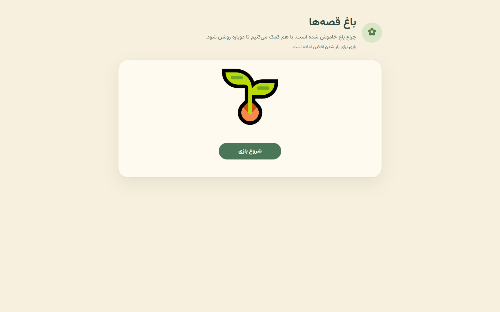
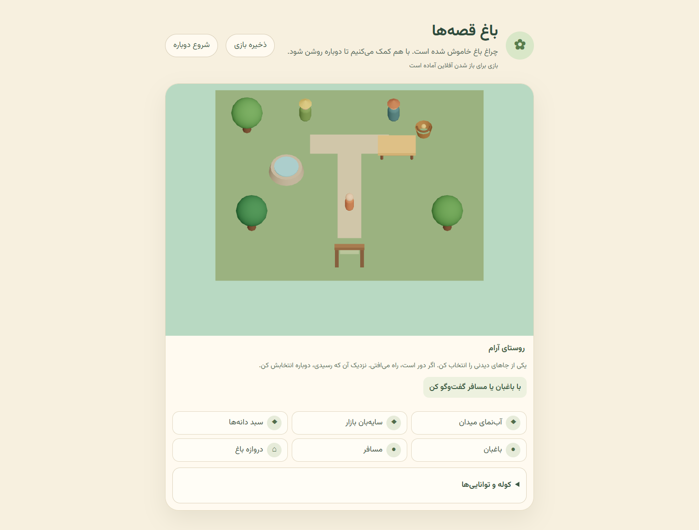
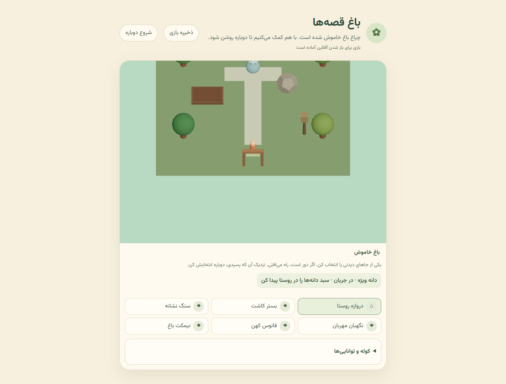
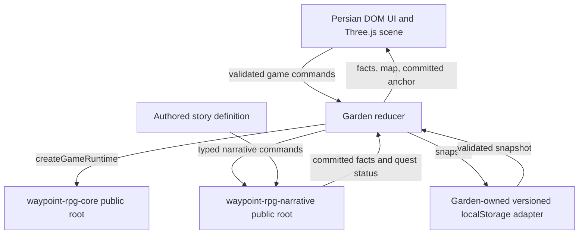

# باغ قصه‌ها — Garden of Stories

Garden of Stories is a small, offline-capable Persian 3D RPG that exercises the
public `waypoint-rpg-core` and `waypoint-rpg-narrative` packages in a second
independent game. Talk to the gardener or traveler in the village, explore the
connected garden, complete that character's objective, and return to see one of
two persistent outcomes.

The interface is Persian and right-to-left. Text, dialogue, quests, and endings
are HTML rather than canvas textures. The sample has no backend, accounts,
tracking, or runtime API requests. Its browser save uses a Garden-only storage
key and cannot change either the Kids RPG profile database or the scene-demo
save.

## Real browser captures

These images are captured from the production build with Chromium and software
WebGL. The adjacent `provenance.json` files record the source commit and each
image's dimensions and SHA-256 hash. They are documentation examples, not
pixel-perfect regression baselines.

| Scene                       | Screenshot                                                                                                   |
| --------------------------- | ------------------------------------------------------------------------------------------------------------ |
| Title                       |                          |
| Village                     |                                         |
| Persian NPC conversation    |                                |
| Story choice                |                           |
| Garden before the objective |          |
| Gardener outcome            |      |
| Traveler outcome            |  |
| Ending                      |                                           |
| Portrait                    |                               |
| Reloaded save               |               |

## Architecture



The core runtime is the authoritative state machine for the application-owned
`GardenState`. Its reducer validates map ownership, target ownership, exact
arrival anchors, and interaction rules. The navigation graph and
`findPath`/`getAnchor` operations come from the core package. Movement only
advances after the reducer receives the next valid `ARRIVE` command; knowing
that a target is reachable does not count as reaching it.

The narrative package owns dialogue cursors, conditional choices, typed facts,
quest lifecycle, trigger conditions, replay protection, and terminal endings.
`src/content/story.ts` is the only location for Garden story definitions.
`src/content/fa/ui.ts` holds sample-owned interface copy. Neither story nor
character data belongs in the reusable packages.

`src/scenes/registry.ts` maps each Garden map to its public core `WorldMap` and
navigation graph. `GardenScene.tsx` projects the committed map, anchor, and
narrative facts into the active Three.js scene. The `tree-grown` fact adds the
blossom tree; `lantern-lit` adds visible emissive light and a point light. The
renderer never dispatches quest effects or writes narrative state.

Procedural geometry is sample-owned. The model components in
`src/scenes/GardenScene.tsx` are the visual replacement seam: a later version
can replace those components with locally bundled `.glb` assets while keeping
their positions, target ownership, narrative facts, and interaction commands
unchanged. This sample does not require generated models or an asset service.

## Runtime and narrative integration

The runtime composes `createGameRuntime<GardenState, GardenCommand>` with a
pure reducer. UI controls dispatch commands and subscribe through
`useSyncExternalStore`; no Redux or parallel global store is used. The sample
imports the core root for `createGameRuntime`, `findPath`, `getAnchor`, and
world/navigation types.

At startup the game calls `validateNarrative`, then `compileNarrative`, and
creates one narrative state with `createNarrativeState`. Each valid choice or
trigger calls `transitionNarrative` with that state's playthrough ID and
expected revision. `getDialogueView`, `getQuestStatus`, and `getFact` provide
read-only UI and renderer projections. Save restoration passes the stored
snapshot through `decodeNarrativeState` before the runtime accepts it. All of
these are imports from `waypoint-rpg-narrative`'s public package root.

The gardener path starts `gardener-quest`, records the found seed, and completes
when the player interacts with the planting bed after the seed is found. Its
committed `tree-grown` and `garden-outcome` facts produce a blossoming tree. The
traveler path starts `lantern-quest`, requires the hidden clue before the
ancient lantern, then commits `lantern-lit` and a different outcome. Invalid
order, wrong map, distant target, stale movement, and duplicate one-time
triggers cannot bypass those rules.

## Persistence and offline behavior

`src/persistence/garden-save.ts` owns a storage adapter and a strict version-1
envelope under `waypoint-rpg:garden-adventure:save`. It stores the current map,
known anchor, and validated narrative snapshot. The reducer and narrative
package do not access browser storage. Progress saves at stable arrivals and
can be saved manually; the title screen offers Continue or a new playthrough.

Corrupt, incompatible, unsupported-version, and unavailable storage states are
handled explicitly. Corrupt bytes are retained until the player chooses to
clear the old save. A temporary session is available when storage cannot be
used. Reset removes only the Garden key and starts a new narrative playthrough.
The scoped native service worker caches same-origin production assets and
supports an offline return after the first successful installation.

## Develop, build, test, and play

Use the repository's pinned Node.js 22 and npm 10 toolchain. From the
repository root:

```bash
npm ci
npm run sample:garden:dev
npm run sample:garden:build
npm run sample:garden:test
npm run sample:garden:e2e
npm run framework:garden-consumer
```

For offline screenshot capture, install the Playwright Chromium browser once,
then run:

```bash
npx playwright install chromium
npm run sample:garden:previews
```

The command builds the sample, starts its production preview, waits for the
ready service worker and a rendered non-empty orthographic scene, and drives
both complete stories. It writes the ten screenshots and
`docs/previews/garden-adventure/provenance.json`. It rejects screenshots that
are missing, unexpectedly small, not PNGs, or inconsistent with their recorded
image hashes. The sample has no screenshot-only scene or fabricated UI state.

`npm run framework:garden-consumer` builds and packs the framework packages,
copies the sample to a temporary directory outside this checkout, installs the
archives there, checks public ESM and declaration resolution, rejects private
package imports, and runs the production browser smoke from the isolated
consumer. Installing the locked development tools is a separate `npm ci` step
from installing the local framework archives offline.

## Known limits

- Browser gameplay and captures are verified in Chromium with software WebGL;
  other browsers and physical touch devices are not yet verified.
- The story is intentionally short and has no combat, inventory, accounts, or
  network service.
- The 3D art is procedural placeholder geometry. A licensed local GLB pipeline
  can replace it behind the sample-owned model components.
- Vite currently reports the expected large Three.js production chunk warning.
